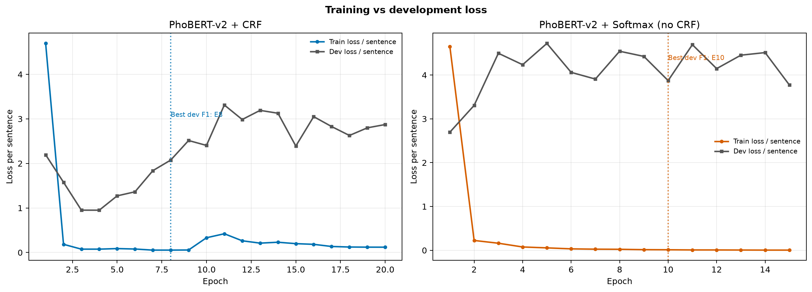
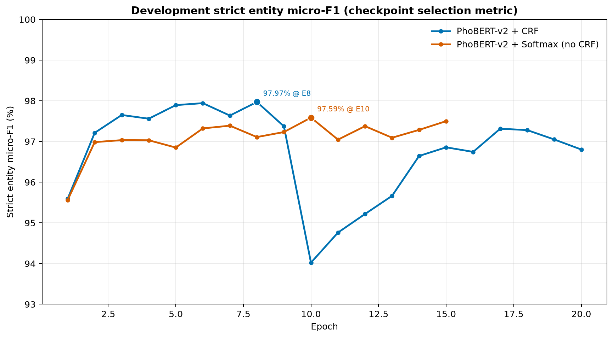

# PAP_NER + PhoBERT-v2 for Vietnamese NER

Các notebook và kết quả huấn luyện/đánh giá PhoBERT-v2 trên bộ dữ liệu **PAP_NER**. Repository lưu riêng hai cấu hình mô hình: **CRF** và **Softmax (không dùng CRF)**.

## Cấu trúc repository

### CRF

- `notebooks/PAP_NER_PhoBERT_v2_CRF_1epoch.ipynb` — notebook Kaggle để xác minh pipeline trong một epoch.
- `notebooks/PAP_NER_PhoBERT_v2_CRF_20epoch.ipynb` — notebook cấu hình thí nghiệm trên Vast.ai.
- `artifacts/PAP_NER_PhoBERT_v2_CRF_20epoch_results.zip` — checkpoint, runner, tokenizer, cấu hình và báo cáo đánh giá CRF.

### Softmax (không dùng CRF)

- `notebooks/PAP_NER_PhoBERT_v2_Softmax_EvalPlus.ipynb` — notebook huấn luyện và đánh giá PhoBERT-v2 với classification head Softmax.
- `artifacts/papner_phobert_v2_softmax_20ep_rtx3090_24gb-results.zip` — checkpoint, runner, tokenizer, biểu đồ train và báo cáo đánh giá Softmax.

Hai file ZIP kết quả được lưu bằng Git LFS.

## Notebook trên Kaggle

[PhoBERT-v2 test 1 epoch trên Kaggle (CRF)](https://www.kaggle.com/code/dsfsdfdssdfdsf/phobert-v2-test-1-epoch-fs/notebook)
[PhoBERT-v2 + CRF, dataset Dedup 70/15/15, 1 epoch trên Kaggle](https://www.kaggle.com/code/dsfsdfdssdfdsf/pap-ner-phobert-v2-crf-1epoch-kaggle)

## Kết quả test split

| Cấu hình | Entity strict precision | Entity strict recall | Entity strict micro F1 |
| --- | ---: | ---: | ---: |
| PhoBERT-v2 + CRF | 0.9888 | 0.9721 | 0.9804 |
| PhoBERT-v2 + Softmax, không CRF | 0.9923 | 0.9645 | 0.9782 |

Các chỉ số được trích từ `test_metrics.json`; báo cáo đầy đủ nằm trong từng file ZIP.

## So sánh hai lần chạy và kiểm tra training

Bảng chỉ số theo từng chế độ đánh giá, siêu tham số, phân tích split và đồ thị loss/F1: [reports/experiment-comparison.md](reports/experiment-comparison.md).





## Clone và tải artifacts

Cần cài Git LFS để lấy các file ZIP đầy đủ:

```bash
git lfs install
git clone https://github.com/nobody-nothing-nowhere-just-kurumi/papner-phobert-v2-crf.git
cd papner-phobert-v2-crf
git lfs pull
```

Nếu chưa cài Git LFS, clone vẫn lấy được notebook và README nhưng các file ZIP lớn sẽ chỉ là con trỏ LFS.
