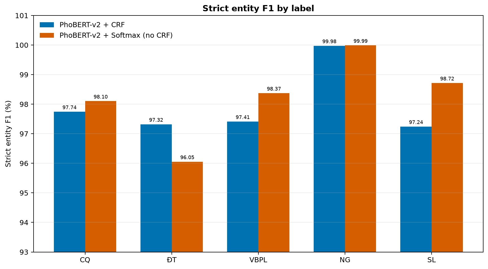

# So sánh hai lần chạy PhoBERT-v2 trên PAP_NER

Báo cáo này chỉ so sánh **hai lần chạy hiện có**: PhoBERT-v2 + CRF và PhoBERT-v2 + Softmax (không CRF). Số liệu lấy từ artifacts trong repo; không gộp với kết quả của các mô hình trong paper.

## Tóm tắt

| Chỉ số trên test | PhoBERT-v2 + CRF | PhoBERT-v2 + Softmax | CRF − Softmax |
| --- | ---: | ---: | ---: |
| Strict entity P / R / F1 (%) | 98.75 / 97.22 / **97.98** | 99.17 / 96.54 / **97.84** | +0.14 pp F1 |
| Partial entity P / R / F1 (%) | 99.21 / 97.67 / **98.43** | 99.49 / 96.86 / **98.16** | +0.27 pp F1 |
| Entity type P / R / F1 (%) | 99.60 / 98.05 / **98.82** | 99.77 / 97.13 / **98.43** | +0.39 pp F1 |
| Exact P / R / F1 (%) | 98.76 / 97.22 / **97.98** | 99.18 / 96.55 / **97.85** | +0.13 pp F1 |

Các chỉ số trong bảng này được tính bằng **nervaluate 0.2.0** từ prediction đã lưu trong hai ZIP. Chúng hơi khác `test_metrics.json` (seqeval): file đó ghi CRF strict micro F1 98.0408% và Softmax 97.8219%. Không trộn hai scorer trong cùng phép so sánh. Đây là một seed mỗi cấu hình, nên chưa có độ lệch chuẩn.

## Thông tin mô hình và dữ liệu

| Thành phần | PhoBERT-v2 + CRF | PhoBERT-v2 + Softmax |
| --- | --- | --- |
| Encoder / head | PhoBERT-v2 / Linear + CRF | PhoBERT-v2 / Linear Softmax |
| Segmentation / tokenizer | VnCoreNLP (word) / BPE | VnCoreNLP (word) / BPE |
| Kích thước vocab | 63,996 | 63,996 |
| Dataset revision | `7a0f6b1233667702925baa69c07c55d5d26eb6cd` | `7a0f6b1233667702925baa69c07c55d5d26eb6cd` |
| Seed / max length | 42 / 256 | 42 / 256 |
| Train / dev / test | 142,218 / 10,305 / 10,278 câu | 142,218 / 10,305 / 10,278 câu |
| Best checkpoint | Epoch 8 (dev strict micro F1) | Epoch 10 (dev strict micro F1) |
| Epochs đã chạy | 20 | 15 |
| Eval batch / early-stop patience | 64 / 20 | 32 / 5 |

### Hyperparameter

| Hyperparameter | PhoBERT-v2 + CRF | PhoBERT-v2 + Softmax |
| --- | --- | --- |
| Optimizer | AdamW | AdamW |
| Learning rate encoder | `2e-5` | `2e-5` |
| Learning rate head | `1e-3` (CRF) | `1e-3` (classifier) |
| LR scheduler / warmup | Linear decay / 0.1 | Linear decay / 0.1 |
| Batch size train | 32 | 32 |
| Weight decay / epsilon | 0.01 / `1e-6` | 0.01 / `1e-6` |
| Gradient clipping | Max norm 1.0 | Max norm 1.0 |
| Dropout / precision | 0.1 / FP16 | 0.1 / FP16 |

## Đường cong huấn luyện

Loss được lưu theo **mỗi câu**. CRF negative log-likelihood và Softmax cross-entropy là hai objective khác nhau, vì vậy so sánh hình dạng trong từng panel có ý nghĩa hơn so sánh trị tuyệt đối giữa hai panel.

| Loại thực thể | CRF P / R / F1 (%) | Softmax P / R / F1 (%) | Δ F1 (CRF − Softmax, pp) |
| --- | --- | --- | ---: |
| CQ | 98.94 / 96.58 / 97.74 | 99.31 / 96.92 / 98.10 | -0.36 |
| ĐT | 98.29 / 96.36 / 97.32 | 98.68 / 93.56 / 96.05 | +1.27 |
| VBPL | 97.12 / 97.71 / 97.41 | 98.19 / 98.55 / 98.37 | -0.96 |
| NG | 99.98 / 99.98 / 99.98 | 100.00 / 99.98 / 99.99 | -0.01 |
| SL | 97.72 / 96.77 / 97.24 | 99.02 / 98.41 / 98.72 | -1.47 |
| Macro F1 (trung bình F1 từng loại) | 97.94% | 98.25% | -0.31 pp |

## Kiểm tra tính độc lập của split

Dataset revision và hash các split trong artifacts khớp với dữ liệu đã kiểm tra. Không có câu trùng chính xác giữa train–dev hoặc train–test. Nhưng **dev và test trùng 3,303 câu duy nhất; 5,285/10,278 dòng test (51.42%) thuộc phần trùng**. Các câu trùng có nhãn BIO giống nhau. Vì thế test không phải tập held-out độc lập với dev; điểm test hiện tại không nên được xem là ước lượng độc lập.

Đáng chú ý, phần test trùng dev có F1 thấp hơn phần test không trùng dev ở cả hai mô hình, nên kiểm tra này **không chứng minh** overlap đã làm F1 tăng. Nó vẫn là vấn đề về tính hợp lệ của phép đo và cần tạo split test độc lập trước khi báo cáo cuối cùng.

## Dấu hiệu cần điều tra trong training

1. **Softmax: dấu hiệu overfit / confidence quá cao.** Train loss giảm từ 4.651 xuống 0.00417, trong khi dev loss dao động khoảng 2.696–4.721; dev F1 tốt nhất ở epoch 10 rồi không tăng ổn định. Cần log thêm token-level accuracy, calibration và kiểm tra loss masking/padding, nhưng chưa thể kết luận lỗi chỉ từ đường cong.
2. **CRF: spike đột ngột ở epoch 10–11.** Train loss tăng từ khoảng 0.05 lên 0.331/0.421; dev loss tăng tới 3.311 và dev F1 rơi mạnh ở epoch 10. Sau đó điểm hồi phục. Kiểm tra learning rate riêng của CRF, scaler FP16/gradient overflow, gradient norm và thứ tự khôi phục optimizer/scheduler khi lưu checkpoint.
3. **Checkpoint.** CRF best dev checkpoint là epoch 8 nhưng job chạy hết 20 epoch vì patience 20; test dùng best checkpoint. Softmax chọn epoch 10 trong 15 epoch. Biểu đồ xác nhận kết quả báo cáo dùng epoch tốt nhất theo dev, không phải epoch cuối.
4. **Cột nhãn dataset cần xác minh với nguồn dữ liệu.** README dataset mô tả 4 trường, nhưng các dòng dữ liệu có 5 trường. Runner dùng cột thứ 4, nơi có 11 lớp BIO dự kiến; cột thứ 5 gần như toàn `O`, nhưng có 644 tag `B-ĐT` và trùng trên những dòng có `B-CQ` ở cột thứ 4. Không nên đổi cột train/eval trước khi xác nhận cột 5 là nhãn phụ hay lỗi export.
5. **Không kết luận kết quả cao hơn paper là lỗi chỉ từ bảng.** So với các giá trị paper trong ảnh (PhoBERT 97.51±0.03; PhoBERT+CRF 97.95±0.01), strict micro F1 theo nervaluate ở đây cao hơn lần lượt khoảng 0.33 và 0.03 điểm phần trăm. Khác scorer, một seed, và dev–test overlap khiến phép so sánh chỉ có tính tham khảo.

## Tái lập

Artifacts chứa runner, cấu hình, predictions, metrics và history cho từng lần chạy. Xem `../artifacts/PAP_NER_PhoBERT_v2_CRF_20epoch_results.zip` và `../artifacts/papner_phobert_v2_softmax_20ep_rtx3090_24gb-results.zip`.
